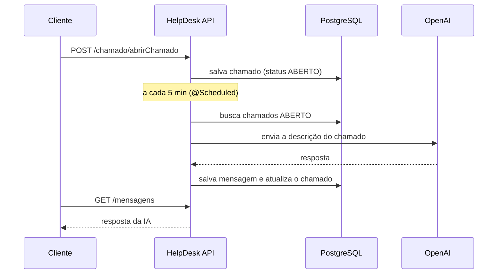

# HelpDesk com IA

API REST de help desk em **Java e Spring Boot**. Clientes abrem chamados, atendentes os gerenciam, e um job agendado envia os chamados abertos para a **API da OpenAI**, que responde como um suporte técnico de nível 1.

## Funcionalidades

- **Cliente:** cadastro, login, abrir/listar/alterar/excluir os próprios chamados e ler as respostas da IA
- **Atendente:** listar todos os chamados, alterar status, excluir chamados e cadastrar outros atendentes
- **Resposta automática:** a cada 5 minutos, os chamados com status `ABERTO` são enviados à OpenAI e a resposta é salva como mensagem do chamado
- **Segurança:** autenticação JWT stateless, dois perfis (`ROLE_CLIENTE` e `ROLE_ATENDENTE`) e isolamento entre usuários (um cliente nunca acessa chamados ou mensagens de outro)

## Fluxo da IA



## Tecnologias

Java 17 · Spring Boot 4 (Web, Data JPA, Security) · PostgreSQL · Flyway · JWT (java-jwt) · BCrypt · MapStruct · WebClient · Swagger (springdoc-openapi) · JUnit 5 · Mockito · H2 (testes) · Docker Compose · Maven

## Documentação da API (Swagger)

Com a aplicação rodando, a documentação interativa fica em:

**http://localhost:8081/swagger-ui.html**


## Coleção do Postman

A pasta [`docs/postman`](docs/postman) tem uma coleção com **todas as rotas** da API, já organizada na ordem de uso:

1. Autenticação e usuários
2. Chamados (cliente)
3. Chamados (atendente)
4. Mensagens (cliente)
5. Segurança (testes negativos: sem token, token inválido e cliente em rota de atendente)
6. Exclusão de chamados

**Como usar:**
1. No Postman, clique em **Import** e selecione `docs/postman/HelpDesk.postman_collection.json`
2. Com a API rodando, execute **Login - cliente** e **Login - atendente**: os tokens e os ids são salvos automaticamente nas variáveis da coleção, e as demais requisições já usam esses valores
3. A URL base (`baseUrl`) e as credenciais de teste ficam nas variáveis da coleção e podem ser editadas

## Endpoints

| Método | Rota | Perfil | Descrição |
|---|---|---|---|
| POST | `/usuario/cadastrar` | Público | Cadastra um cliente |
| POST | `/usuario/login` | Público | Login, retorna o token JWT |
| POST | `/usuario/atendente/cadastrar` | Atendente | Cadastra um atendente |
| POST | `/chamado/abrirChamado` | Cliente | Abre um chamado |
| GET | `/chamado` | Cliente | Lista os próprios chamados |
| GET | `/chamado/{id}` | Cliente | Consulta um chamado |
| PUT | `/chamado/alterar/{id}` | Cliente | Altera um chamado |
| DELETE | `/chamado/deletar/{id}` | Cliente | Exclui um chamado |
| GET | `/chamado/atendente/listar` | Atendente | Lista todos os chamados |
| GET | `/chamado/atendente/listar/{id}` | Atendente | Consulta qualquer chamado |
| PUT | `/chamado/atendente/status/{id}` | Atendente | Altera o status |
| DELETE | `/chamado/atendente/deletar/{id}` | Atendente | Exclui qualquer chamado |
| GET | `/mensagens` | Cliente | Lista as mensagens do usuário logado |
| GET | `/mensagens/{id}` | Cliente | Consulta uma mensagem |

As rotas protegidas exigem o header `Authorization: Bearer <token>`, obtido em `/usuario/login`.
Quando um cliente tenta acessar um recurso de outra pessoa, a API responde **404** (e não 403), para não revelar que o recurso existe.

## Como rodar

**Pré-requisitos:** Java 17+, Docker e uma chave da API da OpenAI.

1. **Clone o repositório**
   ```bash
   git clone https://github.com/J0A0PAULO/spring-boot-ai-helpdesk.git
   cd spring-boot-ai-helpdesk
   ```

2. **Crie o arquivo `.env`** na raiz (ele está no `.gitignore`, nunca faça commit dele):
   ```env
   SPRING_SECURITY_SECRET=um-segredo-longo-e-aleatorio
   IA_KEY=sua-chave-da-openai
   GPT_URL=https://api.openai.com/v1
   ```
   > O Spring não lê o `.env` sozinho. Defina essas variáveis no terminal ou na configuração de execução da sua IDE.

3. **Suba o banco** (as tabelas são criadas pelo Flyway na primeira execução):
   ```bash
   docker compose up -d postgres
   ```

4. **Rode a aplicação**
   ```bash
   ./mvnw spring-boot:run
   ```
   A API fica em `http://localhost:8081`.

> **Usuário de teste:** ao subir, a aplicação cria um atendente `atendente@gmail.com` com senha `123`. Ele existe só para desenvolvimento local e deve ser removido antes de qualquer deploy.

## Testes

```bash
./mvnw test
```

Testes unitários dos services (JUnit 5 + Mockito), incluindo os casos de acesso negado entre usuários, e um teste de contexto que sobe a aplicação com H2 em memória (perfil `test`).

## Melhorias futuras

- [ ] Validação de entrada com Bean Validation (`@Valid`) e resposta 409 para e-mail duplicado
- [ ] Status do chamado como `enum`
- [ ] Extrair a chamada à OpenAI para uma classe própria e testá-la isoladamente
- [ ] Testes de controllers (`@WebMvcTest`) e de repositories (`@DataJpaTest`)
- [ ] Botão *Authorize* do Swagger configurado para o JWT
- [ ] Deploy com link público

## Autor

**João Paulo dos Santos Moreira**

[](https://www.linkedin.com/in/jo%C3%A3o-paulo-dos-santos-moreira-b52b7b174/)
[](https://github.com/J0A0PAULO)
